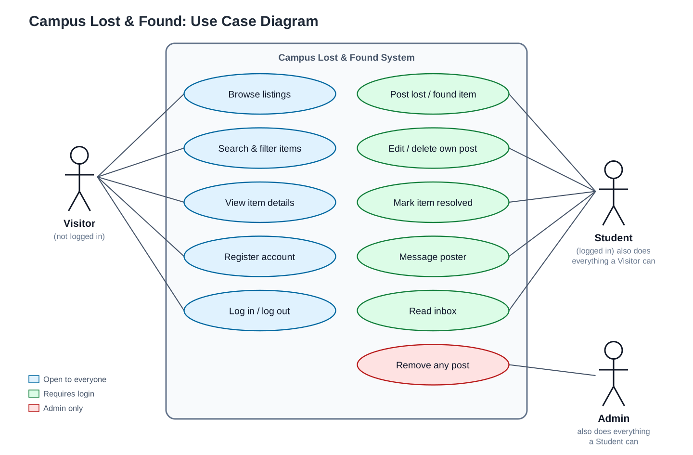
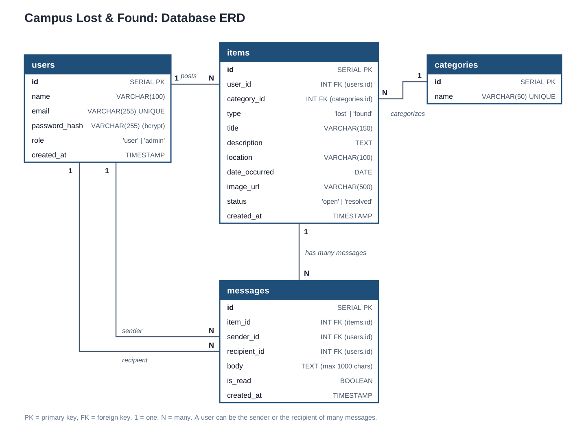
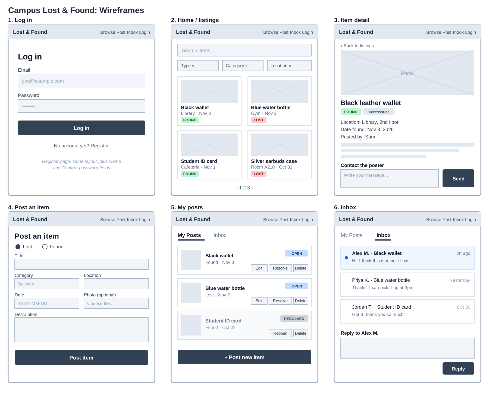

# campus-lost-and-found
# PROJECT PITCH

A web app where students post lost or found items, search by category and location, and contact each other securely without exposing personal info.

# USER STORIES

Accounts

As a student, I want to register and log in so that I can post and message about items.
  
Posting

- As a student, I want to post a lost or found item with a photo so that the owner or finder can see it.
- As a poster, I want to edit or delete my post so that listings stay accurate.
- As a poster, I want to mark an item as resolved so that people stop contacting me about it.

Browsing

- As a visitor, I want to browse recent items so that I can check if mine is there.
- As a student, I want to search and filter by keyword, category, and location so that I can find items quickly.
- As a student, I want to view an item’s details so that I know enough to contact the poster.

Messaging

- As a student, I want to message the poster without seeing their email so that my privacy is protected.
- As a poster, I want an inbox so that I can respond to people about my items.

Admin

- As an admin, I want to remove inappropriate posts so that the site stays safe.

# USE CASE DIAGRAM

# ERD

# WIREFRAME

